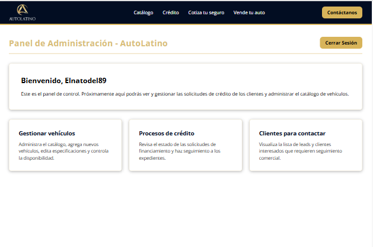

# AutoLatino


Aplicación web para una concesionaria de vehículos. AutoLatino permite explorar el inventario, enviar solicitudes de contacto y crédito, y administrar vehículos, solicitudes y contactos desde un panel interno.

> **Estado:** El desarrollo funcional está terminado. La prueba de despliegue está pendiente.
>
> **Demo y cuentas de prueba:** El enlace de la demo y el usuario y contraseña se publicarán después de validar el despliegue.

## Funcionalidades

- Catálogo público de vehículos con filtros y páginas de detalle.
- Formulario de contacto con seguimiento de mensajes desde el panel.
- Solicitudes de crédito con archivos adjuntos y consulta del estado del proceso.
- Panel administrativo para gestionar vehículos, solicitudes de crédito y contactos.
- Inicio de sesión mediante Firebase Authentication.

## Capturas de pantalla

Reemplaza estas rutas con las capturas del proyecto cuando estén disponibles:




## Arquitectura y tecnologías

- **Frontend:** React 19, TypeScript, Vite 8 y React Router DOM 7.
- **Datos:** Firebase Firestore para vehículos, contactos y solicitudes de crédito.
- **Autenticación:** Firebase Authentication.
- **Archivos:** Cloudinary almacena imágenes públicas de vehículos y archivos privados de solicitudes.
- **Backend:** ASP.NET Core Minimal API sobre .NET 10. Se encarga de subir, firmar, descargar y eliminar archivos privados de Cloudinary; Firestore sigue siendo la capa de datos de la aplicación.
- **Estilos y calidad:** CSS Modules y Oxlint.

## Estructura del proyecto

- `src/`: aplicación frontend en React y TypeScript (componentes, páginas, contextos, hooks, servicios y tipos).
- `backend/`: API ASP.NET Core Minimal API para operaciones de archivos con Cloudinary.

La estructura completa del proyecto está documentada en [`actual.md`](./actual.md).

## Requisitos

- Node.js y npm.
- .NET 10 SDK.
- Un proyecto de Firebase con Authentication y Firestore configurados.
- Una cuenta de Cloudinary.

## Configuración local

El frontend y el backend se ejecutan en terminales separadas.

### 1. Configurar Firebase y el frontend

Crea un archivo `.env` en la raíz y configura los valores de la aplicación web de Firebase y la URL local del backend:

```dotenv
VITE_FIREBASE_API_KEY=
VITE_FIREBASE_AUTH_DOMAIN=
VITE_FIREBASE_PROJECT_ID=
VITE_FIREBASE_STORAGE_BUCKET=
VITE_FIREBASE_MESSAGING_SENDER_ID=
VITE_FIREBASE_APP_ID=
VITE_API_URL=http://localhost:5022
```

Habilita Firebase Authentication y configura las reglas de Firestore para tu proyecto. Las variables `VITE_*` se incluyen en el código del navegador; no pongas secretos en ellas.

### 2. Configurar Cloudinary para el backend

Configura las variables `CloudinarySettings__CloudName`, `CloudinarySettings__ApiKey` y `CloudinarySettings__ApiSecret` en el entorno donde ejecutarás la API. No guardes credenciales reales en `appsettings.json` ni las subas al repositorio.

### 3. Iniciar la aplicación

Terminal del frontend:

```bash
npm install
npm run dev
```

Terminal del backend, con las variables de Cloudinary configuradas:

```bash
dotnet run --project backend/backend.csproj --launch-profile http
```

El backend local escucha en `http://localhost:5022`, que debe coincidir con `VITE_API_URL`. CORS está configurado para los orígenes locales `http://localhost:5173` y `http://localhost:3000`. Si cambias variables del frontend, reinicia Vite para que las vuelva a cargar.

## Scripts del frontend

```bash
npm run dev      # Inicia el servidor de desarrollo
npm run build    # Verifica TypeScript y genera la compilación
npm run lint     # Ejecuta Oxlint
npm run preview  # Previsualiza la compilación
```

## API de archivos

| Método | Ruta | Descripción |
|---|---|---|
| `POST` | `/api/upload/cedula` | Sube un archivo privado a Cloudinary. |
| `GET` | `/api/cedula-url/{publicId}` | Genera una URL firmada para un archivo privado. |
| `GET` | `/api/download/{publicId}` | Descarga un archivo privado. |
| `POST` | `/api/delete` | Elimina un archivo de Cloudinary. |

## Flujo de ramas

- `main`: versión estable del proyecto.
- `develop`: rama de integración para el trabajo en curso.
- `feature/*`: crea una rama por funcionalidad a partir de `develop`; al terminar, intégrala en `develop`. Cuando la integración esté lista para publicarse, pasa los cambios de `develop` a `main`.

## Validación pendiente para el despliegue

- Validar las reglas de Firestore: el frontend accede directamente a sus colecciones.
- Verificar la autorización para operaciones administrativas y endpoints del backend. CORS y el estado de sesión del frontend no sustituyen autorización.
- Reemplazar los orígenes CORS locales por los dominios del despliegue.
- Validar los archivos recibidos y el tratamiento de datos personales, especialmente documentos de crédito.
- Mantener las credenciales de Cloudinary en configuración protegida del servidor.
- Después de la prueba de despliegue, publicar el enlace de la demo y las credenciales de prueba.

## Licencia

Proyecto privado. Todos los derechos reservados.
